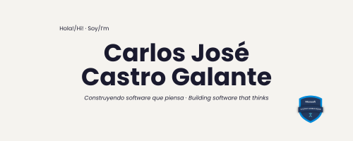
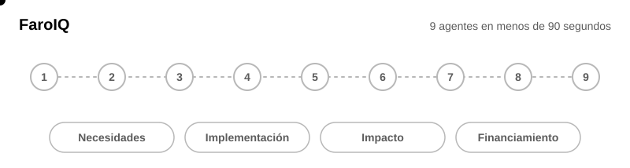

<picture>
  <source media="(prefers-color-scheme: dark)" srcset="assets/roles_dark.svg">
  <source media="(prefers-color-scheme: light)" srcset="assets/roles_light.svg">
  
</picture>

Software Developer y Azure AI Engineer radicado en Argentina.
Certificado por Microsoft (AI-102 · AI-900 · AZ-900) y por el ITBA · Microsoft Student Ambassador 2026.
Actualmente cursando Diseño de Software en la Universidad Nacional de Catamarca.

Construyo aplicaciones web e integro inteligencia artificial en productos que tienen que funcionar en producción.
Mi foco está en arquitectura limpia, impacto real y hacer que las cosas complejas se sientan simples.

[Portfolio](https://carlosjcastrog.com) · [LinkedIn](https://linkedin.com/in/carlosjcastrog) · [Certificaciones](https://certificar.carlosjcastrog.com) · [carlosjcastrog.dev@gmail.com](mailto:carlosjcastrog.dev@gmail.com)

---

## Cómo trabajo

Esto es lo que tengo en cuenta cuando armo un producto yo solo.

<picture>
  <source media="(prefers-color-scheme: dark)" srcset="assets/principios_dark.svg">
  <source media="(prefers-color-scheme: light)" srcset="assets/principios_light.svg">
  
</picture>

---

## Con qué trabajo

Las tecnologías que uso todos los días, agrupadas según la parte del producto donde las aplico.

<picture>
  <source media="(prefers-color-scheme: dark)" srcset="assets/journey_dark.svg">
  <source media="(prefers-color-scheme: light)" srcset="assets/journey_light.svg">
  
</picture>

---

## Proyectos seleccionados

### [FaroIQ](https://faroiq.vercel.app)

Pipeline de 9 agentes de IA construido sobre Azure AI Foundry para ONGs en América Latina.
Produce análisis de necesidades, planes de implementación, proyecciones de impacto y propuestas de financiamiento en menos de 90 segundos.
Construido solo para el Microsoft Agents League Hackathon 2026.

<picture>
  <source media="(prefers-color-scheme: dark)" srcset="assets/faroiq_dark.svg">
  <source media="(prefers-color-scheme: light)" srcset="assets/faroiq_light.svg">
  
</picture>

`Python` `FastAPI` `React` `Azure AI Foundry` `Microsoft 365` · [Código](https://github.com/carlosjcastro/faroiq)

### [DuckBank](https://github.com/carlosjcastro/duckbank)

Home banking full stack con autenticación, transferencias y gestión de préstamos.

<picture>
  <source media="(prefers-color-scheme: dark)" srcset="assets/duckbank_dark.svg">
  <source media="(prefers-color-scheme: light)" srcset="assets/duckbank_light.svg">
  
</picture>

`React` `Django` `Django REST Framework` `PostgreSQL` · [Código](https://github.com/carlosjcastro/duckbank)

### [Framejury](https://github.com/carlosjcastro/framejury)

Asistente de selección de fotos para eventos que funciona sin conexión.
Agrupa ráfagas casi idénticas, elige el mejor cuadro de cada grupo y explica cada foto que descarta.
Presentado en el Hacktoberfest 2026 de DEV.

<picture>
  <source media="(prefers-color-scheme: dark)" srcset="assets/framejury_dark.svg">
  <source media="(prefers-color-scheme: light)" srcset="assets/framejury_light.svg">
  
</picture>

`Python` `FastAPI` `Next.js` `Gemma 4` `Ollama` · [Código](https://github.com/carlosjcastro/framejury)

---

## Programas y participaciones

- **Microsoft Student Ambassador** · Community Influencer · 2026
- **Stanford Code in Place 2026** · Proyecto final seleccionado para el showcase público
- **Microsoft Agents League Hackathon 2026** · FaroIQ
- **Dev3Pack Hackathon 2026** · VeriMatChain AI
- **Microsoft AI Skills Fest 2025** · Guinness World Record

---

<picture>
  <source media="(prefers-color-scheme: dark)" srcset="assets/footer_dark.svg">
  <source media="(prefers-color-scheme: light)" srcset="assets/footer_light.svg">
  
</picture>
